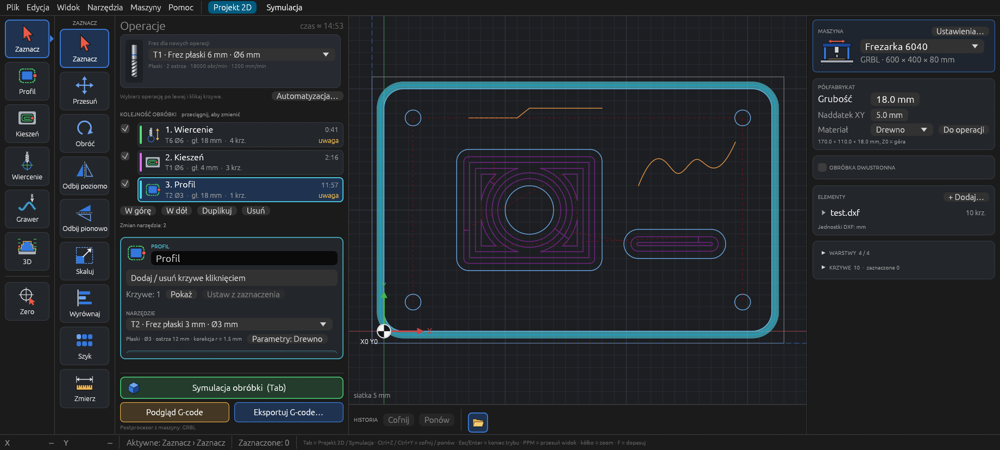
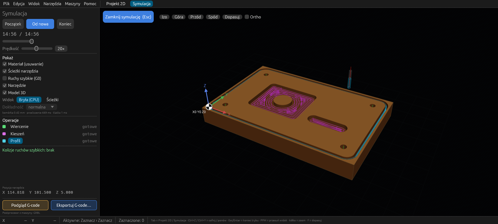
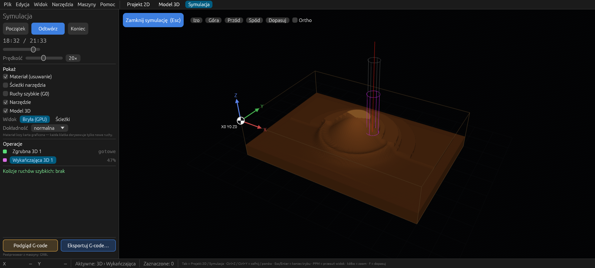

#  Millwise

**Po polsku:** [README_pl.md](README_pl.md) · **Changes:** [CHANGELOG.md](CHANGELOG.md) · **For developers:** [DEVELOPMENT.md](DEVELOPMENT.md)

> **Early development — not ready for use.** Millwise is at a very early stage
> (version 0.7.1). It changes every day and the G-code it writes has not been
> tested on real machines. **Please do not use it to run a CNC machine yet.**
> A first test version for Linux can be downloaded (see below). Feedback and
> ideas are welcome in the issues.

Millwise is a free CAM program for 3-axis CNC routers and mills. It turns DXF
drawings and STL models into toolpaths and writes G-code for **GRBL /
FluidNC** and **LinuxCNC**. It is written in Rust and runs on Linux (a Windows version is
not planned for now). The user interface is in Polish and English.



## What it does (0.7.1)

- **DXF import:** lines, arcs, circles, polylines with arcs, splines,
  ellipses and blocks; loose pieces are joined into contours, inches are
  converted to millimetres.
- **Operations:** pick a tool and an operation on the left toolbar, then
  click the curves in the 2D view. The machining order is changed by
  dragging the operations in the list; one click puts operations with the
  same tool together, for fewer tool changes.
  - **Profile** outside / inside, with tabs, ramp or arc lead-in, stock to
    leave and a finishing pass (with its own feed).
  - **Pocket** offset, zigzag or HSM (small even step-over, rounded loops),
    with islands and a finishing pass.
  - **Corners (dog-bones)** in inside profiles and pockets, so square parts
    fit.
  - **Drilling:** single, peck, or helical hole milling.
  - **Engraving** on the line, on its left or on its right, with a ramp
    entry.
  - **V-carving:** a V cutter with the depth following the width of the
    shape.
- **3D machining of STL models:** the model sits in the stock (units, scale,
  90° rotations, stock left above it) and has its own „3D model” tab.
  - **Roughing** in Z levels around the model, with extra levels above flat
    areas.
  - **Finishing** with parallel passes, waterlines (constant heights, for
    steep walls), **combined** (waterlines on steep places, parallel
    passes on gentle ones), **spiral** or **radial**, limited to a slope range if needed (e.g. flat
    places only), and **rest finishing** only where a bigger tool could not
    reach.
  - **Cut-out** along the model silhouette with tabs; silhouette and outline
    at any height also as curves for 2D operations.
  - Undercut warning; 3D toolpaths are computed in the background.
- **3D shape from curves:** selected closed curves (lettering, a logo)
  become a raised model — flat, rounded, bevelled or domed edges, or
  recessed.
- **Relief from a photo:** open a JPG, PNG or BMP image and it becomes a 3D
  model — bright places higher, dark lower (or inverted), with width, depth,
  base, smoothing and mesh spacing. Machined like an STL model.
- **Text** turned into curves (built-in fonts or any .ttf / .otf).
- **Automation:** operations for all free curves by layer, corners, tabs by
  perimeter and order by tool in one step.
- **Two-sided machining** with dowel pin holes and mirrored side B.
- **Editing:** move, rotate, mirror, scale, align, array, cut / copy / paste,
  measure;
  set the program zero at a stock corner, its centre or a picked point.
  **Undo and redo** with a history bar: one icon per action, a click goes
  back to it.
- **Several files in one project:** add DXF drawings and other projects
  (with their operations) to the current one; the elements list shows what
  the project is made of.
- **Tool library** shared by all projects, with a visual choice of the cutter
  type (flat, ball, tapered ball, bull nose, V, engraving, drill), cutting
  data per material (wood, MDF, aluminium, acrylic) and a basic set of flat,
  ball and V cutters and drills in 3, 4 and 6 mm; the tools are grouped by
  type.
- **Machines** with a picture of the machine type: work area, homing corner, controller, feed and rapid limits,
  spindle, tool change (M0 pause, M6 or one file per tool), coolant, custom
  program start and end. Operations are checked against the machine.
- **3D simulation** of material removal with playback, seeking,
  per-operation progress and detection of rapid moves into the material —
  computed by the graphics card (smooth for programs of any size) or, on
  weak graphics, by the processor on an exact solid. A „Toolpaths” view
  shows the target model with the layer being cut.
- **Projects** (`.millwise`) keep the drawing, the stock, the operations and
  copies of the tools used.





## Planned

Waterlines only on steep areas with parallel passes on the gentle ones, 3D
on side B, toolpaths drawn by the graphics card in the 2D view, Linux
packages. See [TODO.md](TODO.md) (in Polish) and the changelog.

## Download (Linux)

The [Releases](https://github.com/cyryllo/millwise/releases) page has an
**AppImage**: one file, nothing to install. It runs on Debian 12 / 13,
Ubuntu 22.04 or newer and other distributions of that age.

```sh
chmod +x Millwise-0.7.1-x86_64.AppImage
./Millwise-0.7.1-x86_64.AppImage
```

Millwise chooses OpenGL by itself on NVIDIA cards and when the default
graphics cannot open the window. If the window still does not open, start it
with `--gl`.

## Building from source

With a recent stable Rust (tested with 1.99):

```sh
git clone https://github.com/cyryllo/millwise.git
cd millwise
cargo run --release -p millwise -- samples/demo.millwise
```

On Linux, `packaging/linux/install-local.sh` installs the built program, its
icon and a menu entry for the current user. An AppImage can be built with
`packaging/linux/build-appimage-docker.sh` (needs Docker, see
[DEVELOPMENT.md](DEVELOPMENT.md)).

## License

Copyright © 2026 Cyryl Sochacki.

Millwise is free software under the **GNU General Public License v3 or later**
(`GPL-3.0-or-later`, see [LICENSE](LICENSE)). You may use it, also
commercially, change it and share it, as long as changed versions are shared
under the same licence together with their source code.

It comes **without any warranty**. Always check the G-code before running it
on a machine.

The libraries it uses keep their own permissive licences; the list is in
[THIRD-PARTY.md](THIRD-PARTY.md).
