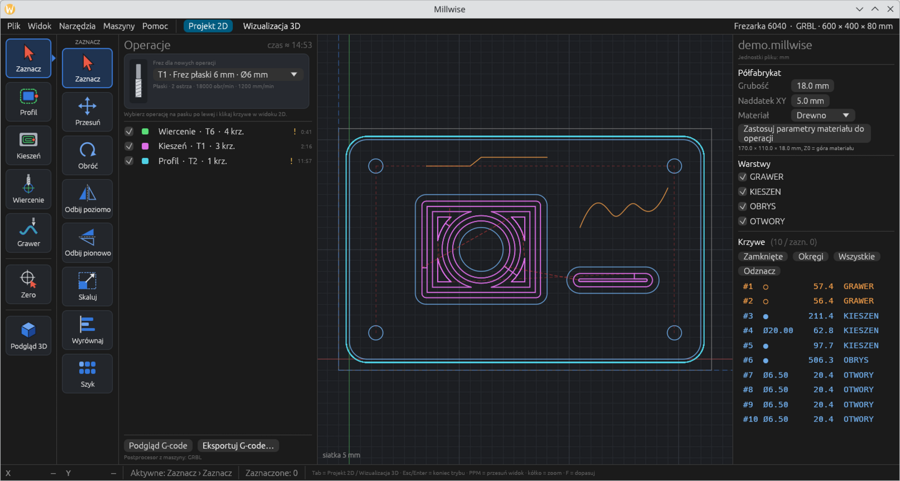
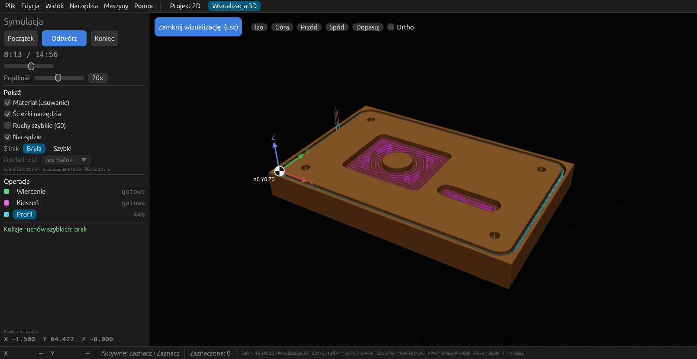

#  Millwise

**Po polsku:** [README_pl.md](README_pl.md) · **Changes:** [CHANGELOG.md](CHANGELOG.md) · **For developers:** [DEVELOPMENT.md](DEVELOPMENT.md)

> **Early development — not ready for use.** Millwise is at a very early stage
> (version 0.1.0). It changes every day, there are no releases or installers
> yet, and the G-code it writes has not been tested on real machines. **Please
> do not use it to run a CNC machine yet.** Feedback and ideas are welcome in
> the issues.

Millwise is a free CAM program for 3-axis CNC routers and mills. It turns DXF
drawings into toolpaths and writes G-code for **GRBL / FluidNC** and
**LinuxCNC**. It is written in Rust and runs on Linux and Windows. The user
interface is in Polish for now.



## What it does (0.1.0)

- **DXF import:** lines, arcs, circles, polylines with arcs, splines,
  ellipses and blocks; loose pieces are joined into contours, inches are
  converted to millimetres.
- **Operations:** pick a tool and an operation on the left toolbar, then
  click the curves in the 2D view.
  - **Profile** outside / inside, with tabs, ramp entry and stock to leave.
  - **Pocket** offset or zigzag, with islands.
  - **Drilling:** single, peck, or helical hole milling.
  - **Engraving** on the line, on its left or on its right.
- **Editing:** move, rotate, mirror, scale, align, array; set the program
  zero at a stock corner, its centre or a picked point.
- **Tool library** shared by all projects, with a visual choice of the cutter
  type (flat, ball, bull nose, V, engraving, drill) and cutting data per
  material (wood, MDF, aluminium, acrylic).
- **Machines:** work area, homing corner, controller, feed and rapid limits,
  spindle, tool change (M0 pause, M6 or one file per tool), coolant, custom
  program start and end. Operations are checked against the machine.
- **3D simulation** of material removal on a real solid (Boolean operations),
  with playback, seeking, per-operation progress and detection of rapid moves
  into the material.
- **Projects** (`.millwise`) keep the drawing, the stock, the operations and
  copies of the tools used.



## Planned

STL import and 3D machining (drop-cutter), adaptive pocketing, V-carving,
installers for Windows and Linux. See the changelog for what is done.

## Building from source

There are no packages yet. With a recent stable Rust (tested with 1.99):

```sh
git clone https://github.com/cyryllo/millwise.git
cd millwise
cargo run --release -p millwise -- samples/demo.millwise
```

On Linux, `packaging/linux/install-local.sh` installs the built program, its
icon and a menu entry for the current user. An AppImage can be built with
`packaging/linux/build-appimage-docker.sh` (needs Docker, see
[DEVELOPMENT.md](DEVELOPMENT.md)).

## License

Copyright © 2026 Cyryl Sochacki.

Millwise is free software under the **GNU General Public License v3 or later**
(`GPL-3.0-or-later`, see [LICENSE](LICENSE)). You may use it, also
commercially, change it and share it, as long as changed versions are shared
under the same licence together with their source code.

It comes **without any warranty**. Always check the G-code before running it
on a machine.

The libraries it uses keep their own permissive licences; the list is in
[THIRD-PARTY.md](THIRD-PARTY.md).
