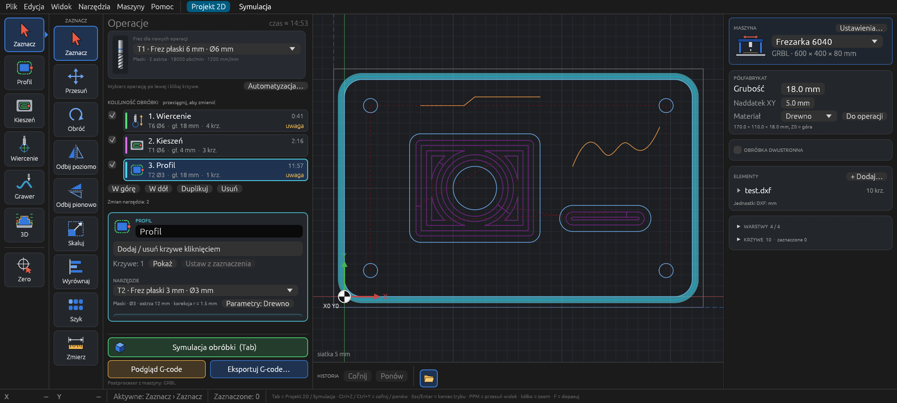
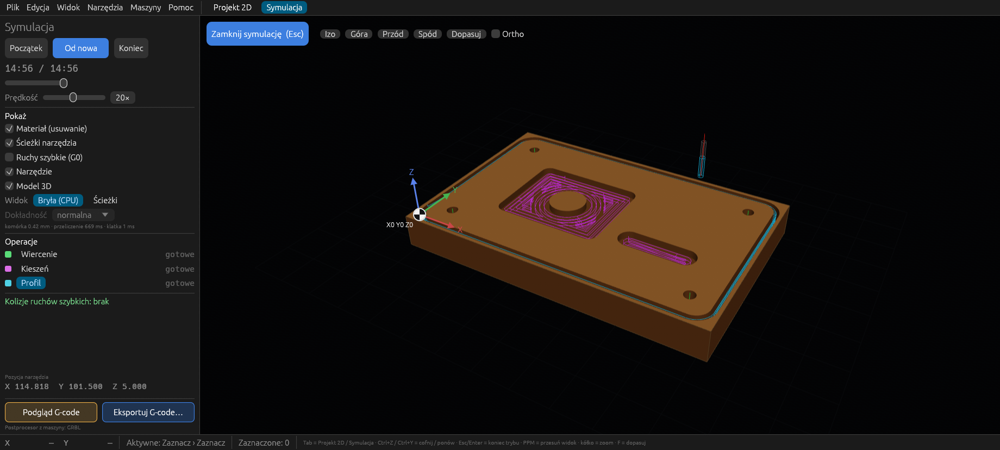
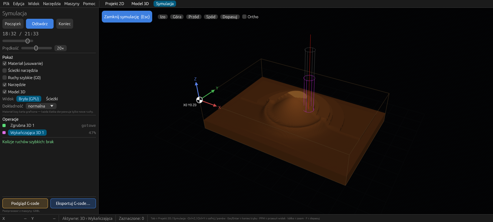

#  Millwise

**English:** [README.md](README.md) · **Zmiany:** [CHANGELOG.md](CHANGELOG.md) · **Dla programistów:** [DEVELOPMENT.md](DEVELOPMENT.md)

> **Wczesny etap rozwoju — wersja testowa.** Millwise jest na wczesnym etapie
> (wersja 0.8.0) i zmienia się codziennie. Pierwsze próby jego G-code na
> prawdziwej frezarce (sterownik FluidNC) przebiegły dobrze, ale wymiary nie
> były jeszcze mierzone, LinuxCNC nie był sprawdzany na maszynie, a obróbka 3D
> nie była sprawdzana na maszynie. Zawsze sprawdzaj G-code przed
> uruchomieniem — używasz programu na własną odpowiedzialność. Uwagi i
> pomysły chętnie przyjmujemy w zgłoszeniach (Issues).

Millwise to darmowy program CAM dla 3-osiowych frezarek CNC. Z rysunków DXF,
modeli STL i zdjęć (jako płaskorzeźby) tworzy ścieżki narzędzia i zapisuje
G-code dla **GRBL / FluidNC** oraz **LinuxCNC**. Jest napisany w Rust i działa
na Linuksie (wersji dla Windows na razie nie planujemy). Interfejs jest po
polsku i po angielsku.

**Strona i instrukcja obsługi z obrazkami:** https://cyryllo.github.io/millwise/pl/



## Co potrafi (0.8.0)

- **Import DXF:** linie, łuki, okręgi, polilinie z łukami, splajny, elipsy i
  bloki; luźne elementy są łączone w kontury, cale przeliczane na milimetry.
- **Operacje:** wybierasz narzędzie i operację na pasku po lewej, potem
  klikasz krzywe w widoku 2D. Kolejność obróbki zmieniasz, przeciągając
  operacje na liście; jednym kliknięciem ustawisz operacje tym samym frezem
  po sobie, żeby było mniej zmian narzędzia.
  - **Profil** zewnętrzny / wewnętrzny, z mostkami, rampą albo wejściem po
    łuku, naddatkiem i przejściem wykańczającym (z własnym posuwem).
  - **Kieszeń** offsetowa, zygzak albo HSM (mały, równy krok, zaokrąglone
    pętle), z wyspami i przejściem wykańczającym.
  - **Uszka w narożnikach** profili wewnętrznych i kieszeni — kwadratowe
    elementy wchodzą do końca.
  - **Wiercenie:** pojedyncze, z wycofaniem albo frezowanie otworu po helisie.
  - **Grawer** po linii, z lewej albo z prawej strony linii, z rampą.
  - **V-carving:** frez V, głębokość wynika z szerokości kształtu.
- **Obróbka 3D modeli STL:** model w półfabrykacie (jednostki, skala,
  obroty o 90°, naddatek nad modelem), z własną zakładką „Model 3D”.
  - **Zgrubna** warstwami Z wokół modelu, z dodatkowymi warstwami nad
    płaskimi miejscami.
  - **Wykańczająca** równoległa, warstwicowa (stałe wysokości — strome
    ściany), **łączona** (warstwice na stromym, równoległa na łagodnym),
    **spiralna** albo **promieniowa**,
    z ograniczeniem do zakresu nachylenia (np. tylko płaskie miejsca), oraz
    **resztki** tylko tam, gdzie większy frez nie sięgnął.
  - **Wycięcie** po sylwetce modelu z mostkami; sylwetka i obrys na dowolnej
    wysokości także jako krzywe do operacji 2D.
  - Ostrzeżenie o podcięciach; ścieżki 3D liczą się w tle.
- **Kształt 3D z krzywych:** zaznaczone zamknięte krzywe (napis, logo)
  stają się wypukłym modelem — z krawędzią płaską, zaokrągloną, skośną albo
  kopułą, albo wklęsłym.
- **Płaskorzeźba ze zdjęcia:** otwórz obraz JPG, PNG albo BMP, a powstanie
  z niego model 3D — jasne miejsca wyżej, ciemne niżej (albo odwrotnie), z
  szerokością, głębokością, podstawą, wygładzaniem i dokładnością siatki.
  Obrabiany jak model STL.
- **Napisy** zamieniane na krzywe (wbudowane czcionki albo dowolny plik
  .ttf / .otf).
- **Automatyzacja:** operacje dla wszystkich wolnych krzywych według warstw,
  uszka, mostki według obwodu i kolejność według narzędzi jednym krokiem.
- **Obróbka dwustronna** z otworami na kołki ustalające i odbitą stroną B.
- **Edycja:** przesuń, obróć, odbij, skaluj, wyrównaj, szyk, wytnij / kopiuj /
  wklej, zmierz; zero programu w rogu półfabrykatu, w jego środku albo we wskazanym
  punkcie. **Cofanie i ponawianie** z paskiem historii: jedna ikona na
  czynność, kliknięcie wraca do niej.
- **Kilka plików w jednym projekcie:** do bieżącego projektu można dodać
  kolejne rysunki DXF i inne projekty (z ich operacjami); lista elementów
  pokazuje, z czego składa się projekt.
- **Biblioteka narzędzi** wspólna dla wszystkich projektów, z graficznym
  wyborem rodzaju freza (płaski, kulowy, kulowy stożkowy, z promieniem
  naroża, V, grawerski, wiertło), parametrami skrawania dla materiałów
  (drewno, MDF, aluminium, plexi) i zestawem podstawowym: frezy płaskie,
  kulowe i V oraz wiertła 3, 4 i 6 mm; narzędzia pogrupowane według rodzaju.
- **Maszyny** z rysunkiem rodzaju maszyny: pole robocze, narożnik bazowania, sterownik, posuwy maksymalne
  i szybkie, wrzeciono, zmiana narzędzia (pauza M0, M6 albo osobne pliki),
  chłodzenie, własny początek i koniec programu. Operacje są sprawdzane
  względem maszyny.
- **Symulacja 3D** usuwania materiału: odtwarzanie, przewijanie, postęp
  operacji, wykrywanie ruchów szybkich w materiale — liczona przez kartę
  graficzną (płynnie przy każdej wielkości programu) albo, przy słabej
  grafice, przez procesor na dokładnej bryle. Widok „Ścieżki” pokazuje model
  docelowy i aktualnie frezowaną warstwę.
- **Projekty** (`.millwise`) zapisują rysunek, półfabrykat, operacje i kopie
  użytych narzędzi.





## Plany

Grawer na powierzchniach 3D, ostrzeżenie o ocieraniu uchwytu narzędzia o
materiał, przejście ołówkowe i ponowna zgrubna, obróbka 3D na stronie B,
nesting detali 2D na płycie, paczki dla Linuksa. Szczegóły w
[TODO.md](TODO.md) i w CHANGELOG.

## Pobieranie (Linux)

Na stronie [Releases](https://github.com/cyryllo/millwise/releases) jest
**AppImage**: jeden plik, bez instalacji. Działa na Debianie 12 / 13, Ubuntu
22.04 lub nowszym i innych dystrybucjach z tego okresu.

```sh
chmod +x Millwise-0.8.0-x86_64.AppImage
./Millwise-0.8.0-x86_64.AppImage
```

Na kartach NVIDIA i wtedy, gdy domyślna grafika nie otwiera okna, Millwise sam
wybiera OpenGL. Jeśli okno mimo to się nie otwiera, uruchom program z opcją
`--gl`.

## Budowanie ze źródeł

Potrzebny jest aktualny stabilny Rust (testowane na 1.99):

```sh
git clone https://github.com/cyryllo/millwise.git
cd millwise
cargo run --release -p millwise -- samples/demo.millwise
```

Na Linuksie `packaging/linux/install-local.sh` instaluje zbudowany program,
ikonę i skrót w menu dla bieżącego użytkownika. AppImage można zbudować
skryptem `packaging/linux/build-appimage-docker.sh` (potrzebny Docker, szczegóły
w [DEVELOPMENT.md](DEVELOPMENT.md)).

## Licencja

Copyright © 2026 Cyryl Sochacki.

Millwise jest wolnym oprogramowaniem na licencji **GNU GPL v3 lub
późniejszej** (`GPL-3.0-or-later`, plik [LICENSE](LICENSE)). Możesz go używać
(także komercyjnie), zmieniać i rozpowszechniać, pod warunkiem że zmienione
wersje udostępniasz na tej samej licencji razem z kodem źródłowym.

Program jest dostarczany **bez jakiejkolwiek gwarancji**. G-code zawsze
sprawdzaj przed uruchomieniem na maszynie.

Użyte biblioteki zachowują własne, liberalne licencje — lista w
[THIRD-PARTY.md](THIRD-PARTY.md).
