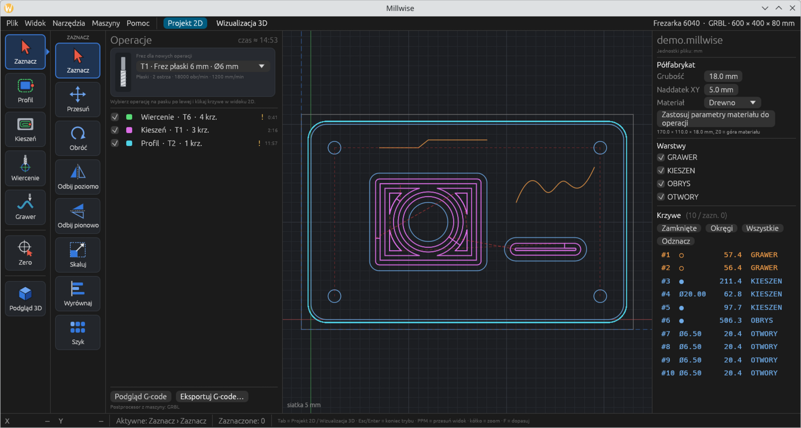
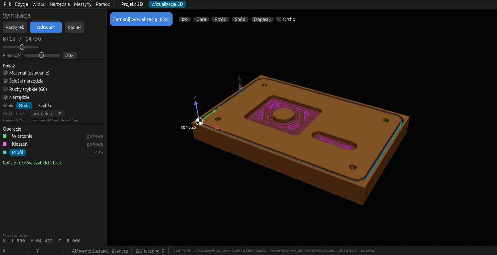

#  Millwise

**English:** [README.md](README.md) · **Zmiany:** [CHANGELOG.md](CHANGELOG.md) · **Dla programistów:** [DEVELOPMENT.md](DEVELOPMENT.md)

> **Wczesny etap rozwoju — jeszcze nie do użytku.** Millwise jest na bardzo
> wczesnym etapie (wersja 0.1.0). Zmienia się codziennie, nie ma jeszcze wydań
> ani instalatorów, a tworzony G-code nie był testowany na prawdziwych
> maszynach. **Na razie nie zalecamy używania go do sterowania frezarką.**
> Uwagi i pomysły chętnie przyjmujemy w zgłoszeniach (Issues).

Millwise to darmowy program CAM dla 3-osiowych frezarek CNC. Z rysunków DXF
tworzy ścieżki narzędzia i zapisuje G-code dla **GRBL / FluidNC** oraz
**LinuxCNC**. Jest napisany w Rust i działa na Linuksie i Windows.



## Co potrafi (0.1.0)

- **Import DXF:** linie, łuki, okręgi, polilinie z łukami, splajny, elipsy i
  bloki; luźne elementy są łączone w kontury, cale przeliczane na milimetry.
- **Operacje:** wybierasz narzędzie i operację na pasku po lewej, potem
  klikasz krzywe w widoku 2D.
  - **Profil** zewnętrzny / wewnętrzny, z mostkami, rampą i naddatkiem.
  - **Kieszeń** offsetowa albo zygzak, z wyspami.
  - **Wiercenie:** pojedyncze, z wycofaniem albo frezowanie otworu po helisie.
  - **Grawer** po linii, z lewej albo z prawej strony linii.
- **Edycja:** przesuń, obróć, odbij, skaluj, wyrównaj, szyk; zero programu w
  rogu półfabrykatu, w jego środku albo we wskazanym punkcie.
- **Biblioteka narzędzi** wspólna dla wszystkich projektów, z graficznym
  wyborem rodzaju freza (płaski, kulowy, z promieniem naroża, V, grawerski,
  wiertło) i parametrami skrawania dla materiałów (drewno, MDF, aluminium,
  plexi).
- **Maszyny:** pole robocze, narożnik bazowania, sterownik, posuwy maksymalne
  i szybkie, wrzeciono, zmiana narzędzia (pauza M0, M6 albo osobne pliki),
  chłodzenie, własny początek i koniec programu. Operacje są sprawdzane
  względem maszyny.
- **Symulacja 3D** usuwania materiału na prawdziwej bryle (operacje
  boolowskie): odtwarzanie, przewijanie, postęp operacji, wykrywanie ruchów
  szybkich w materiale.
- **Projekty** (`.millwise`) zapisują rysunek, półfabrykat, operacje i kopie
  użytych narzędzi.



## Plany

Import STL i obróbka 3D (drop-cutter), kieszeń adaptacyjna, V-carve,
instalatory dla Windows i Linuksa. Co jest gotowe — w CHANGELOG.

## Budowanie ze źródeł

Paczek jeszcze nie ma. Potrzebny jest aktualny stabilny Rust (testowane na 1.99):

```sh
git clone https://github.com/cyryllo/millwise.git
cd millwise
cargo run --release -p millwise -- samples/demo.millwise
```

Na Linuksie `packaging/linux/install-local.sh` instaluje zbudowany program,
ikonę i skrót w menu dla bieżącego użytkownika. AppImage można zbudować
skryptem `packaging/linux/build-appimage-docker.sh` (potrzebny Docker, szczegóły
w [DEVELOPMENT.md](DEVELOPMENT.md)).

## Licencja

Copyright © 2026 Cyryl Sochacki.

Millwise jest wolnym oprogramowaniem na licencji **GNU GPL v3 lub
późniejszej** (`GPL-3.0-or-later`, plik [LICENSE](LICENSE)). Możesz go używać
(także komercyjnie), zmieniać i rozpowszechniać, pod warunkiem że zmienione
wersje udostępniasz na tej samej licencji razem z kodem źródłowym.

Program jest dostarczany **bez jakiejkolwiek gwarancji**. G-code zawsze
sprawdzaj przed uruchomieniem na maszynie.

Użyte biblioteki zachowują własne, liberalne licencje — lista w
[THIRD-PARTY.md](THIRD-PARTY.md).
