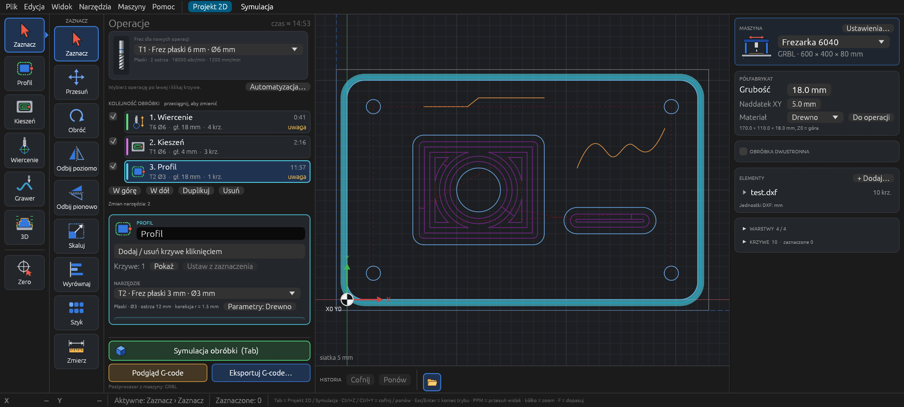
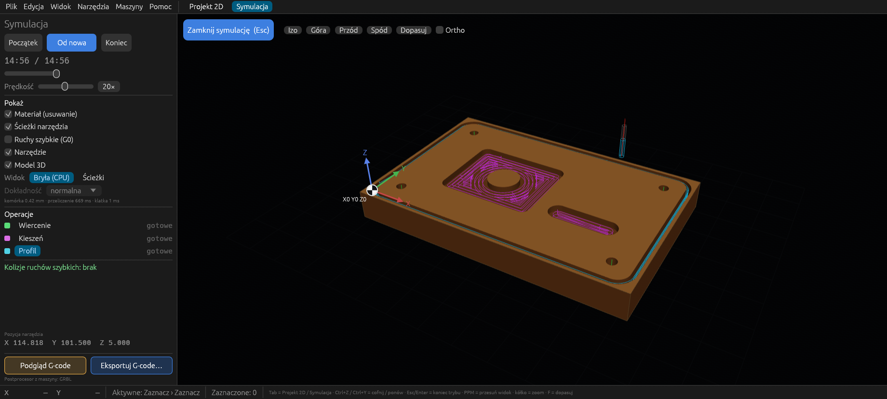
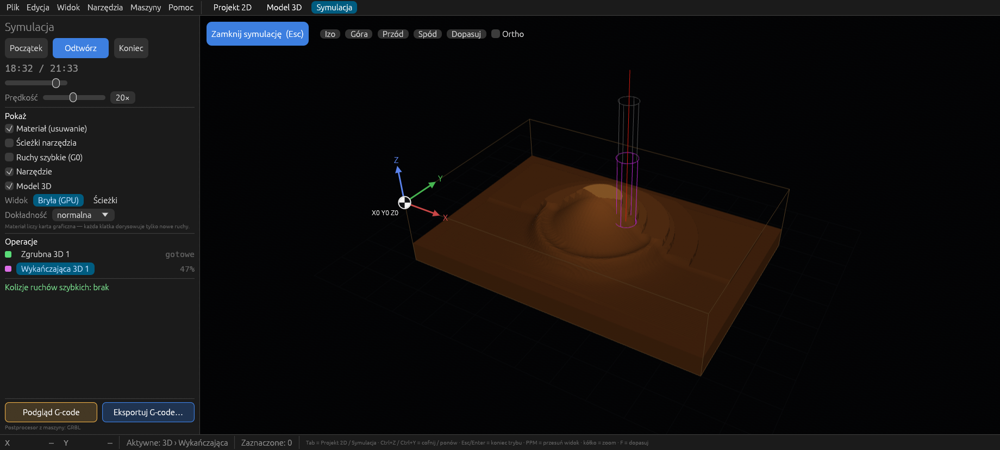

#  Millwise

**English:** [README.md](README.md) · **Polski:** [README_pl.md](README_pl.md) · **更新日志：** [CHANGELOG.md](CHANGELOG.md) · **开发者文档：** [DEVELOPMENT.md](DEVELOPMENT.md)

> **早期开发阶段 — 测试版本。** Millwise 目前处于早期阶段
> （版本 0.8.1），每天都在变化。其 G-code 首次在真实机床（FluidNC 控制器）
> 上运行顺利，但尺寸精度尚未测量，LinuxCNC 尚未在机床上验证，3D 加工也
> 尚未在机床上检查。运行前请务必检查 G-code —— 使用本程序风险自负。
> 欢迎在 Issues 中反馈意见和想法。

Millwise 是一款面向三轴数控雕刻机和铣床的免费 CAM 软件。它可将 DXF
图纸、STL 模型和照片（作为浮雕）转换为刀具路径，并生成适用于
**GRBL / FluidNC** 和 **LinuxCNC** 的 G-code。程序使用 Rust 编写，运行在
Linux 上（目前暂无 Windows 版本计划）。界面支持中文、波兰语和英语。

**网站及带截图的使用指南（英文 / 波兰文）：** https://cyryllo.github.io/millwise/



## 功能（0.8.1）

- **DXF 导入：** 直线、圆弧、圆、带圆弧的 polyline、样条曲线、椭圆和图块；
  零散的片断会连接成轮廓，英寸会换算为毫米。
- **加工操作：** 在左侧工具栏选择刀具和操作，然后在 2D 视图中点击曲线。
  通过拖动操作列表中的条目可调整加工顺序；一键即可将使用同一把刀具的
  操作排在一起，减少换刀次数。
  - **轮廓切割：** 外侧 / 内侧，支持连接桥、斜坡或圆弧下刀、加工余量以及
    精加工走刀（可设置独立进给）。
  - **型腔：** 偏移、之字形或 HSM（小而均匀的步距、圆润的回环），
    支持岛屿和精加工走刀。
  - **角落狗骨形**：用于内轮廓和型腔，让方形零件能够完全贴合。
  - **钻孔：** 单次、啄式或螺旋孔铣削。
  - **雕刻：** 沿线条、线条左侧或右侧，支持斜坡下刀。
  - **V 雕刻：** 使用 V 型刀，深度由形状宽度决定。
- **STL 模型的 3D 加工：** 模型置于毛坯中（单位、缩放、90° 旋转、模型上方
  留料），并拥有独立的“3D 模型”选项卡。
  - **粗加工：** 围绕模型按 Z 层加工，在平坦区域上方额外增加层。
  - **精加工：** 平行走刀、等高线（等高恒定，适合陡壁）、**组合**
    （陡峭处等高线、平缓处平行走刀）、**螺旋**或**径向**，可限制在指定
    坡度范围内（例如仅加工平坦区域），以及仅在较大刀具无法到达处进行
    **残料精加工**。
  - **切割：** 沿模型轮廓带连接桥切出；任意高度的轮廓和外形也可作为曲线
    供 2D 操作使用。
  - 倒扣警告；3D 刀具路径在后台计算。
- **由曲线生成 3D 形状：** 选中的闭合曲线（文字、标志）变为凸起模型——
  边缘可为平面、圆角、斜面或穹顶，也可凹入。
- **照片浮雕：** 打开 JPG、PNG 或 BMP 图像即可生成 3D 模型——亮处更高、
  暗处更低（可反转），可设置宽度、深度、底座、平滑和网格间距。加工方式
  与 STL 模型相同。
- **文字转曲线：** 使用内置字体或任意 .ttf / .otf 字体。
- **自动化：** 一步完成按图层为所有自由曲线创建操作、角落处理、按周长
  布置连接桥以及按刀具排序。
- **双面加工：** 使用定位销孔，B 面镜像。
- **编辑：** 移动、旋转、镜像、缩放、对齐、阵列、剪切 / 复制 / 粘贴、
  测量；可将程序零点设置在毛坯角点、中心或指定点。
  **撤销与重做**配有历史记录栏：每个操作一个图标，点击即可回到该状态。
- **一个项目包含多个文件：** 可将 DXF 图纸和其他项目（含其操作）加入
  当前项目；元素列表显示项目的组成。
- **刀具库：** 所有项目共用，可直观选择刀具类型（平底、球头、锥度球头、
  圆角、V 型、雕刻刀、钻头），按材料（木材、MDF、铝、亚克力）保存切削
  参数，并提供 3 / 4 / 6 mm 的平底、球头、V 型铣刀和钻头基础集；刀具按
  类型分组。
- **机床管理：** 可设置机床类型图示、工作区域、回零角点、控制器、进给与
  快移限制、主轴、换刀方式（M0 暂停、M6 或每把刀单独文件）、冷却液、
  自定义程序开始和结束。操作会对照机床设置进行检查。
- **3D 仿真：** 材料去除过程可播放、跳转、显示各操作进度，并检测快移
  进入材料——由显卡计算（任意大小的程序都流畅），或在较弱显卡上由处理器
  在精确实体上计算。“刀路”视图显示目标模型及正在加工的层。
- **项目**（`.millwise`）保存图纸、毛坯、操作以及所用刀具的副本。





## 计划中

3D 表面雕刻、刀柄与材料干涉警告、铅笔刀和残料粗加工、B 面 3D 加工、
2D 零件在板材上的排样、Linux 安装包。参见 [TODO.md](TODO.md)（波兰语）
和更新日志。

## 下载（Linux）

[Releases](https://github.com/cyryllo/millwise/releases) 页面提供
**AppImage**：单文件，无需安装。适用于 Debian 12 / 13、Ubuntu 22.04
或更新版本，以及同期发布的其他发行版。

```sh
chmod +x Millwise-0.8.1-x86_64.AppImage
./Millwise-0.8.1-x86_64.AppImage
```

Millwise 在 NVIDIA 显卡上以及默认图形无法打开窗口时会自动选择 OpenGL。
如果窗口仍无法打开，请使用 `--gl` 参数启动。

## 从源码构建

需要较新的稳定版 Rust（测试版本为 1.99）：

```sh
git clone https://github.com/cyryllo/millwise.git
cd millwise
cargo run --release -p millwise -- samples/demo.millwise
```

在 Linux 上，`packaging/linux/install-local.sh` 可为当前用户安装编译好的
程序、图标和菜单项。AppImage 可通过
`packaging/linux/build-appimage-docker.sh` 构建（需要 Docker，参见
[DEVELOPMENT.md](DEVELOPMENT.md)）。

## 许可

版权所有 © 2026 Cyryl Sochacki。

Millwise 依据 **GNU 通用公共许可证第 3 版或更新版本**
（`GPL-3.0-or-later`，参见 [LICENSE](LICENSE)）发布为自由软件。您可以
使用它（包括商业用途）、修改并分享它，前提是修改后的版本需以相同许可证
连同源码一起分享。

本软件**不附带任何担保**。上机运行前请务必检查 G-code。

所使用的库保留各自的宽松许可证；列表见 [THIRD-PARTY.md](THIRD-PARTY.md)。
